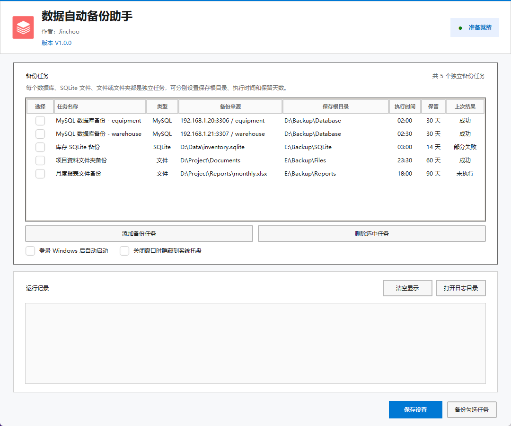
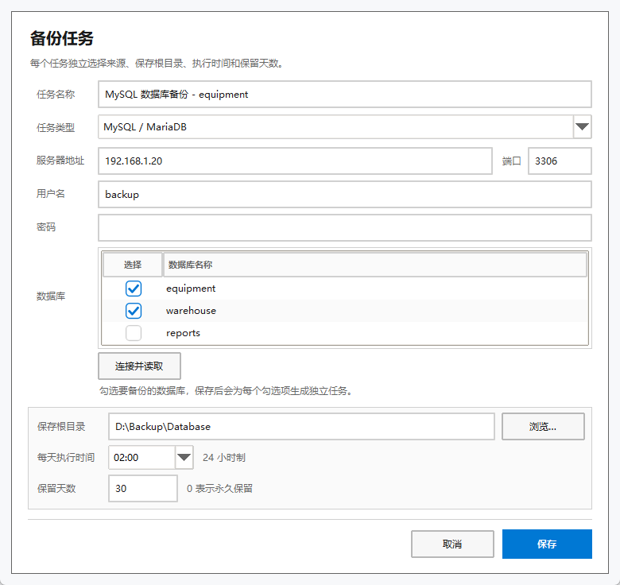
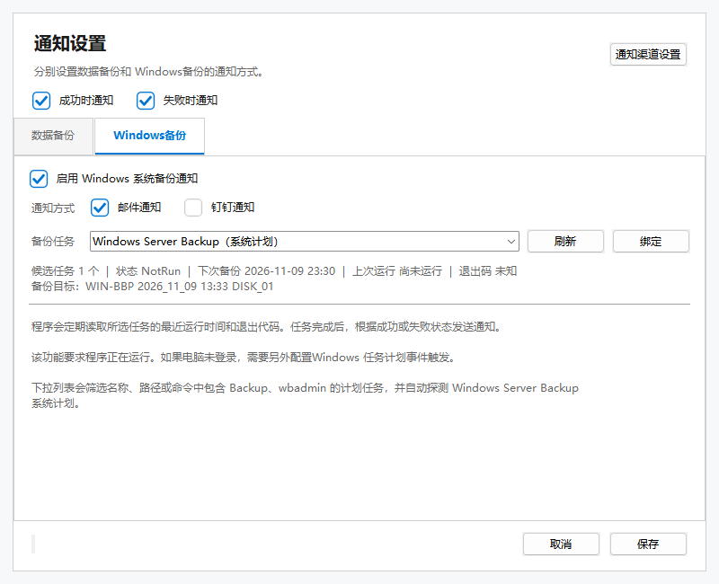
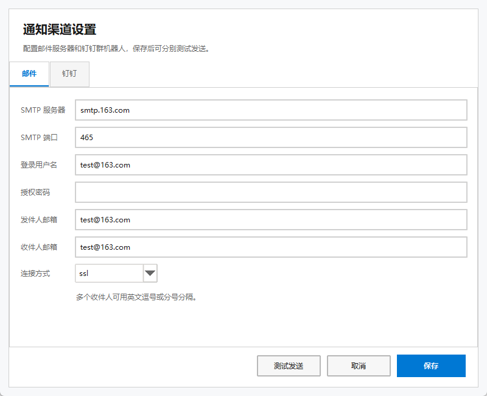

# 数据自动备份助手

**DataBackupAssistant** 是一个面向 Windows 的本地自动备份工具，可统一管理 MySQL / MariaDB、SQLite、文件和文件夹备份任务。

每个备份来源都是独立任务，可以分别设置保存根目录、执行时间和保留天数。程序支持自动备份、手动备份、后台托盘运行和开机自启。

| 项目 | 信息 |
| --- | --- |
| 当前版本 | V1.0.0 |
| 作者 | Jinchoo |
| 运行平台 | Windows |

## 界面预览

<p align="center">
  
</p>

<p align="center"><sub>主界面：统一管理数据库、SQLite、文件和文件夹备份任务</sub></p>

<p align="center">
  
</p>

<p align="center"><sub>添加任务：选择任务类型、数据来源和备份计划</sub></p>

<p align="center">
  
</p>

<p align="center"><sub>通知设置：分别启用数据备份和 Windows备份通知</sub></p>

<p align="center">
  
</p>

<p align="center"><sub>通知渠道设置：邮件和钉钉群机器人分别配置、分别测试</sub></p>

## 核心功能

- **多种备份来源**：支持 MySQL / MariaDB、SQLite、文件和文件夹。
- **独立备份任务**：每个任务分别设置来源、保存根目录、执行时间和保留天数。
- **多数据库备份**：可勾选多个数据库，保存后自动拆分为独立任务。
- **多服务器连接**：不同任务可以使用不同主机、端口和账号。
- **按日归档**：自动在保存根目录下创建 `YYYYMMDD备份` 日期目录。
- **自动定时备份**：按照每个任务自己的执行时间运行。
- **手动立即备份**：可勾选任务后立即执行备份。
- **自动清理**：按任务保留天数清理历史备份，不影响其他任务文件。
- **后台运行**：关闭窗口后可隐藏到 Windows 系统托盘。
- **开机自启**：登录 Windows 后可自动启动备份程序。
- **邮件通知**：备份成功或失败后，通过可配置的 SMTP 邮箱发送结果。
- **钉钉群通知**：支持钉钉群自定义机器人 Webhook、加签和手机号提醒。
- **Windows备份绑定**：可从下拉框绑定 Windows 计划中的备份任务并在完成后通知。
- **密码保护**：MySQL 密码使用 Windows DPAPI 加密保存。
- **备份校验**：备份使用临时文件写入，通过完整性检查后才生成正式 ZIP。
- **文件容错**：文件备份可选择跳过无法读取的文件并记录结果。

## 支持的备份类型

| 类型 | 备份内容 |
| --- | --- |
| MySQL / MariaDB | 数据库结构、数据、视图、存储过程、函数、触发器和事件 |
| SQLite | SQLite 数据库一致性快照 |
| 文件 | 单个文件及其备份说明 |
| 文件夹 | 完整目录结构、文件和空文件夹 |

## 通知设置

点击主界面右下方的“通知设置”：

1. 点击“通知渠道设置”，分别在邮件和钉钉页填写发送参数。
2. 切换到邮件或钉钉页后，点击“测试发送”分别检查当前渠道配置。
3. 返回“通知设置”，在“数据备份”页选择数据备份使用邮件或钉钉通知。
4. 在“Windows备份”页绑定 Windows 备份任务，并选择该备份使用邮件或钉钉通知。
5. 配置完成后点击“保存”。

通知中的 SMTP 密码、钉钉 Webhook 和加签密钥均使用 Windows DPAPI 加密保存。

## 备份规则

- 每个任务按照自己的时间每天执行一次。
- 打开软件时，如果当天计划时间已经过去，不会补做，等待下一次计划时间。
- 所有备份统一保存为 ZIP 文件。
- 同一天的备份存放在同一个日期目录中。
- 同一秒生成的多个 ZIP 会自动追加编号，不会覆盖已有文件。
- 每个 ZIP 包含 `备份说明.txt`，用于记录任务、时间和来源信息。
- 新增或修改计划后，如果当天执行时间已过，会等待下一次计划时间。

## 使用提醒

### 登录后锁屏

按 `Win + L` 锁屏后，只要 Windows 用户仍处于登录状态，程序就会继续运行并执行定时备份。关闭主窗口时，请确保勾选“关闭窗口时隐藏到系统托盘”。

### 重启后无人登录也备份

程序默认通过当前用户的开机启动项运行，因此重启后必须登录 Windows 才会启动。如果需要在登录界面停留时也执行备份，可以使用 Windows 任务计划程序：

1. 按 `Win + R`，输入 `taskschd.msc`，打开任务计划程序。
2. 点击“创建任务”，不要使用“创建基本任务”。
3. 在“常规”中填写任务名称，选择“无论用户是否登录都要运行”。
4. 输入当前 Windows 用户的登录密码，不要勾选“不存储密码”，否则可能无法访问网络中的 MySQL。
5. 在“触发器”中新建每日触发时间。
6. 在“操作”中将程序设置为数据自动备份助手 EXE。
7. 在“添加参数”中填写 `--backup-once`。
8. 在“起始于”中填写 EXE 所在目录。
9. 在“设置”中勾选“如果错过计划开始时间，请尽快启动任务”。
10. 保存任务后，右键任务并选择“运行”，确认日志和备份 ZIP 正常生成。

注意事项：

- `--backup-once` 会在触发时执行全部备份任务，不分别遵守每个任务自己的执行时间。
- 请使用当初保存数据库密码的同一个 Windows 用户运行计划任务，否则无法解密 DPAPI 密码。
- 使用计划任务接管自动备份后，建议取消程序内的“登录 Windows 后自动启动”，并在编辑任务后关闭程序，避免程序内调度和计划任务重复执行。
- 网络数据库、映射网络驱动器或 BitLocker 数据盘必须能在未登录状态下访问，否则备份会失败。
- 备份日志位于：

```text
EXE所在目录\config\logs\backup.log
```

本地备份不能代替异地备份，重要数据建议额外保存到其他磁盘、NAS 或云端。

---

作者：**Jinchoo**

当前版本：**V1.0.0**
