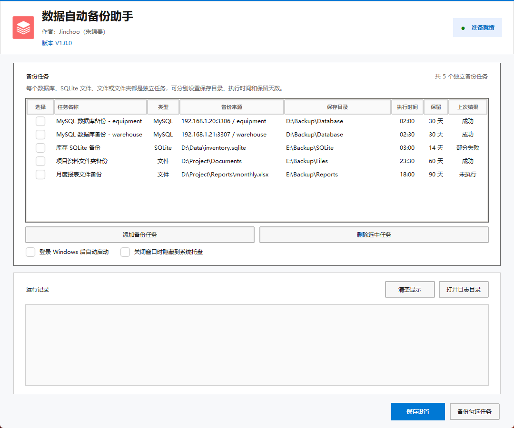

# 数据自动备份助手

**DataBackupAssistant** 是一个面向 Windows 的本地自动备份工具，可统一管理 MySQL / MariaDB、SQLite、文件和文件夹备份任务。

每个备份来源都是独立任务，可以分别设置保存目录、每天执行时间和保留天数。程序支持后台托盘运行、开机自启、立即备份、自动清理和备份结果记录。

| 项目 | 信息 |
| --- | --- |
| 当前版本 | V1.0.0 |
| 作者 | Jinchoo（朱锦春） |
| 运行平台 | Windows |
| 项目语言 | Python 3.12 |
| 数据格式 | ZIP |

## 界面预览

<p align="center">
  
</p>

<p align="center"><sub>主界面：统一管理数据库、SQLite、文件和文件夹备份任务</sub></p>

<p align="center">
  
</p>

<p align="center"><sub>添加任务：选择任务类型、数据来源、备份计划并勾选需要备份的数据库</sub></p>

## 功能特点

- **独立任务**：每个数据库、文件或文件夹都拥有自己的保存目录、执行时间和保留策略。
- **多种来源**：支持 MySQL / MariaDB、SQLite、单个文件以及完整文件夹。
- **多数据库**：一次读取并勾选多个数据库，保存后自动拆分为多个独立任务。
- **多服务器**：不同任务可以连接不同主机、端口和账号，适合多实例数据库环境。
- **自动调度**：程序持续检查任务计划，每个任务每天在指定时间执行一次。
- **后台运行**：关闭主窗口后可以隐藏到系统托盘，托盘菜单支持打开界面和立即备份。
- **开机自启**：登录 Windows 后自动启动，不需要管理员权限。
- **自动清理**：按照每个任务自己的保留天数清理历史备份，不误删其他任务文件。
- **安全保存密码**：MySQL 密码使用 Windows DPAPI 按当前用户加密。
- **完整性检查**：备份先写入临时文件，完成并通过校验后才生成正式 ZIP。
- **文件容错**：文件备份可选择跳过无法读取的文件，并在 `备份说明.txt` 中记录。

## 支持的备份类型

| 类型 | 备份方式 | ZIP 内容 |
| --- | --- | --- |
| MySQL / MariaDB | 使用一致性事务读取结构、数据和数据库对象，导出 SQL 后压缩 | 原始数据库名对应的 `.sql` 文件、`备份说明.txt` |
| SQLite | 通过 SQLite 在线备份接口生成一致性快照 | 原始 SQLite 文件、`备份说明.txt` |
| 文件 | 读取单个文件并压缩 | 原始文件、`备份说明.txt` |
| 文件夹 | 保留目录结构和空文件夹后压缩 | 原始文件夹、`备份说明.txt` |

MySQL 支持表结构、数据、视图、存储过程、函数、触发器和事件。InnoDB 使用一致性快照；MyISAM 表无法提供同等的事务级一致性保证。

## 快速开始

### 运行源码

```powershell
git clone git@github.com:Jinchoo-zhu/DataBackupAssistant.git
cd DataBackupAssistant

python -m venv .venv
.\.venv\Scripts\Activate.ps1
python -m pip install -r requirements.txt

python src\app.py
```

### 使用方式

1. 点击“添加备份任务”。
2. 选择 MySQL / MariaDB、SQLite 或“文件或文件夹”。
3. 填写来源信息、ZIP 保存目录、每天执行时间和保留天数。
4. MySQL 数据库通过首列复选框选择一个或多个数据库。
5. 保存任务，然后点击主界面的“保存设置”。
6. 勾选任务后点击“备份勾选任务”，完成第一次验证。
7. 建议实际解压并测试一次恢复流程。

双击任务行可以修改任务；勾选任务后可以批量删除或立即备份。

## 备份计划

- 每个任务按照自己设置的时间执行，不使用统一备份时间。
- 新增任务或修改执行计划后，如果当天执行时间已经过去，会等待下一天。
- 程序启动时，已有任务如果当天尚未执行且计划时间已过，可以补做当天备份。
- 同一天不会自动重复执行同一任务。
- 手动“备份勾选任务”不受每日自动执行次数限制。
- 请保持电脑开机并登录 Windows，或在关闭窗口后让程序继续驻留系统托盘。

## 文件命名

外层 ZIP 命名格式：

```text
【YYYYMMDDHHMMSS】 任务名称 - 来源名称.zip
```

示例：

```text
【20261103020000】 MySQL 数据库备份 - equipment.zip
```

同一秒、同一目录生成多个 ZIP 时，程序会自动追加 `_2`、`_3`，不会覆盖已有文件。

ZIP 内使用原始数据库、文件或文件夹名称。每个 ZIP 还包含 `备份说明.txt`，记录任务、备份时间和来源路径。

## MySQL 备份账号

建议为自动备份创建专用账号。最低权限示例：

```sql
GRANT SELECT, SHOW VIEW, TRIGGER, EVENT
ON `你的数据库`.* TO 'backup_user'@'%';

GRANT SHOW_ROUTINE ON *.* TO 'backup_user'@'%';
```

如需恢复用户权限或跨实例迁移，应使用具备相应权限的恢复账号。建议 MySQL 备份密码使用英文、数字和常用符号，避免跨系统编码兼容问题。

## 恢复备份

### MySQL / MariaDB

```powershell
Expand-Archive '.\【20261103020000】 MySQL 数据库备份 - equipment.zip' -DestinationPath .\restore
mysql -u root -p < .\restore\equipment.sql
```

### SQLite

1. 解压任务 ZIP。
2. 停止正在写入该 SQLite 文件的程序。
3. 备份原数据库文件。
4. 使用 ZIP 中的原始 SQLite 文件替换原文件。

### 文件或文件夹

使用任意 ZIP 工具解压。`备份说明.txt` 仅用于记录备份信息，不需要恢复到业务目录。

## 配置与日志

| 内容 | 位置 |
| --- | --- |
| 配置文件 | `%APPDATA%\DataBackupAssistant\config.json` |
| 运行日志 | `%APPDATA%\DataBackupAssistant\logs\backup.log` |
| 默认备份目录 | `%USERPROFILE%\Documents\DataBackups` |

旧名称 `DatabaseBackupAssistant` 的配置会在首次启动新版时自动迁移，旧配置不会主动删除。

## 命令行

```powershell
# 检查数据库、SQLite、文件 ZIP、密码加密和保留策略
python src\app.py --self-test

# 按照当前配置立即执行所有任务
python src\app.py --backup-once

# 隐藏主窗口并启动到系统托盘
python src\app.py --minimized
```

## 测试

```powershell
python -m unittest discover -s tests -v
python src\app.py --self-test
```

编码和静态检查：

```powershell
.\.venv\Scripts\ruff.exe check src tests
.\.venv\Scripts\vulture.exe src tests
```

## 构建 EXE

项目提供 PyInstaller Spec 文件和构建脚本。

直接构建：

```powershell
.\.venv\Scripts\python.exe -m PyInstaller --noconfirm --clean DataBackupAssistant.spec
```

输出：

```text
dist\数据自动备份助手.exe
```

使用构建脚本时，会先重新生成图标，再把成品输出到 `outputs`：

```powershell
powershell -ExecutionPolicy Bypass -File .\build.ps1
```

```text
outputs\数据自动备份助手.exe
```

## 项目结构

```text
DataBackupAssistant/
├── assets/                    # 程序图标、任务栏图标和复选框图片
├── docs/                      # README 界面截图
├── src/
│   ├── app.py                 # 主界面、调度、托盘和命令行入口
│   ├── backup_engine.py       # 数据库与文件备份引擎
│   ├── backup_job_dialog.py   # 添加/编辑备份任务
│   ├── centered_dialogs.py    # 居中提示框
│   ├── config_store.py        # 配置、密码加密和旧配置迁移
│   └── windows_integration.py # 开机自启与窗口定位
├── tests/
│   └── test_core.py
├── create_icon.py             # 生成 PNG 与多尺寸 ICO
├── DataBackupAssistant.spec
├── build.ps1
├── requirements.txt
├── version_info.txt
├── README.md
└── 使用说明.md
```

## 已知限制

- 文件备份不是磁盘快照，正在被独占写入的文件可能无法读取。
- MyISAM 表无法提供 InnoDB 级别的一致性事务保证。
- 开机自启需要用户登录 Windows，不能替代 Windows 服务。
- 本地备份不能代替异地备份。重要数据应至少保存到另一块磁盘、NAS 或云端。

## 后续方向

- Windows VSS 卷影复制。
- 文件增量备份、排除规则和历史版本。
- PostgreSQL、SQL Server 等数据库。
- 备份完成后同步到 NAS、对象存储或云盘。

---

作者：**Jinchoo（朱锦春）**

当前版本：**V1.0.0**
